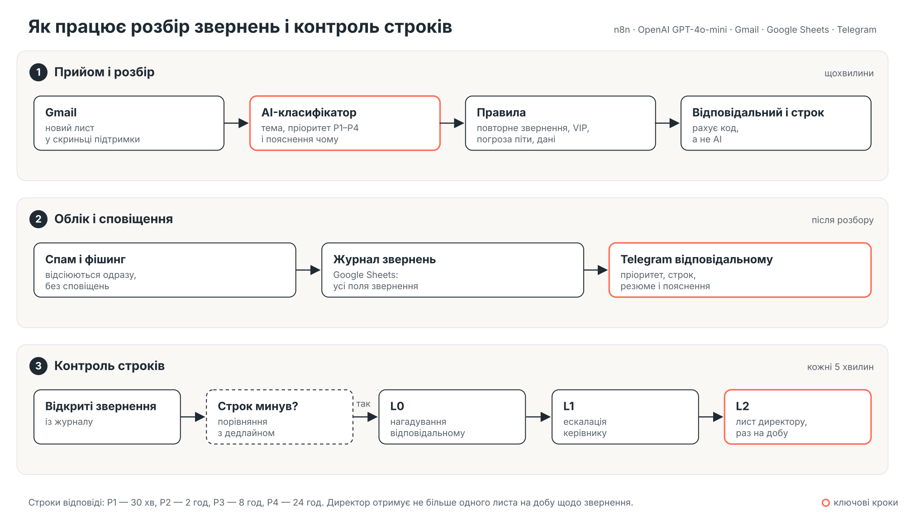
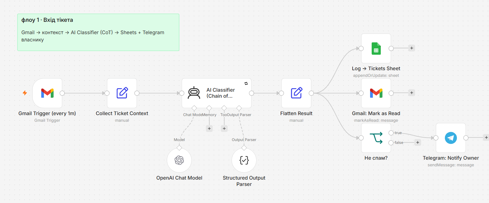
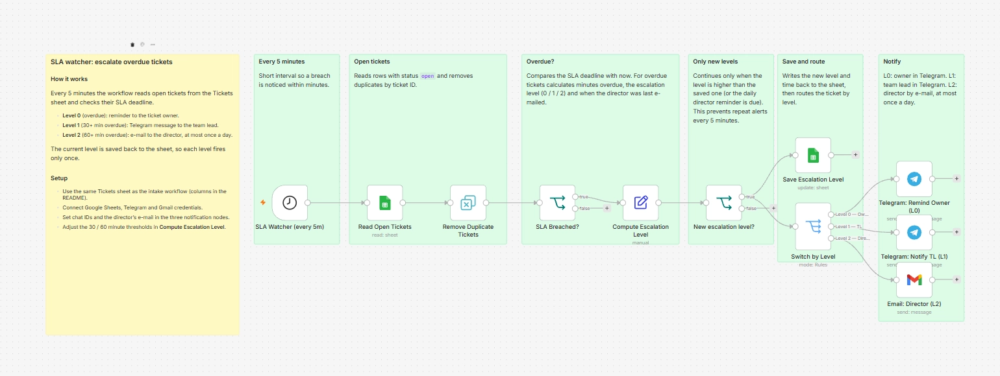
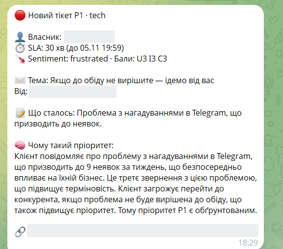

# AI Ticket Routing, SLA Control & Escalation

**Every support e-mail gets a topic, a priority, an owner and a response deadline within seconds, and nobody misses a deadline without the team lead knowing.**

Demo project by Procesto. The scenario is modelled on a fictional SaaS company, SlotHub (online booking for salons and studios), and tested on 24 test tickets in two runs.

## The problem

> "All e-mails land in one inbox. By the time someone figures out who should handle it, a client with a serious problem is already writing for the second time, or leaving for a competitor."

- Requests and spam arrive in one shared inbox.
- Someone reads each e-mail and decides by hand who should get it.
- An urgent outage sits next to an invoice request and an advert.
- There are no priorities or deadlines: some e-mails wait for days.
- If the owner misses a request, nobody notices until the client complains.

## What the system does

1. **AI reads every new e-mail.** It sets the topic (tech, billing, support, sales), a priority from P1 to P4 and an owner.
2. **AI explains its choice.** The manager sees the reasoning, not a black box.
3. **Special rules raise priority:** a repeated request, a threat to leave, a VIP client, a personal-data request. A polite tone does not lower urgency.
4. **Log and alert.** The ticket goes to a log, and the owner gets a Telegram message immediately.
5. **Deadline control every 5 minutes.** When a deadline passes, the system reminds the owner, then the team lead, then the director.
6. **Noise filtered out.** Spam and phishing are filtered out, and the director gets at most one e-mail per day for each ticket.

| Priority | Response deadline | Example |
| --- | --- | --- |
| P1 | 30 min | "Booking has been down in all branches since the morning" |
| P2 | 2 h | "You charged us twice" |
| P3 | 8 h | "Please send the October invoice" |
| P4 | 24 h | "Please add a dark theme" |

## Results on test data

| Metric | Result |
| --- | --- |
| Time to classify one ticket | ≈4 s |
| Topic accuracy | 96% (22 of 23) |
| Priority accuracy | 91% (21 of 23) |
| Missed deadline detected | within 5 min |
| Owner notified | within 1 min |
| AI cost | ≈$0.0003 per ticket |

One SLA watcher run checked 24 open tickets in 5.8 s.

After the first run, three issues were found and fixed:
- Price questions now get at least P3, because they are potential revenue.
- Future clients are no longer confused with support requests.
- The owner and deadline are calculated in code rather than by the model.

Polish-language e-mails were classified correctly, with summaries in Ukrainian.

## Under the hood

- **Intake and classification:** Gmail Trigger (every minute) → AI Agent with chain-of-thought and Structured Output Parser → SLA calculated in code → Google Sheets → Telegram.
- **SLA watcher:** every 5 min → open tickets → escalation L0 owner → L1 team lead → L2 director by e-mail (at most once a day).

**Stack:** n8n · OpenAI GPT-4o-mini · Gmail API · Google Sheets · Telegram Bot API

## Screenshots

**Workflow 1: intake & AI classification**

**Workflow 2: SLA watcher & escalation**

A new P1 ticket in the team's Telegram group, with the AI's reasoning (sender details hidden):

## Workflow files

Both workflows are in [`workflows/`](workflows) with **the classifier prompt removed** and every credential, ID and test record stripped. The SLA logic, escalation levels and notification templates are included.

## Get the full workflow

The classifier prompt and the setup guide are not published. To see the system running on a call, or to get it set up for your inbox, categories and team:

→ **[Fill in a short brief](https://tally.so/r/J1lLxK?utm_source=github&utm_medium=repo&utm_campaign=portfolio&utm_content=ticket-triage-sla)** · [Full case study with video](https://super-kettle-5ea.notion.site/41d396519ffa810eb48fdbd7b1bc7910) · [procesto.eu](https://procesto.eu)

---

© 2026 Procesto. All rights reserved. The workflow files are shared for evaluation only; reuse requires written permission.
